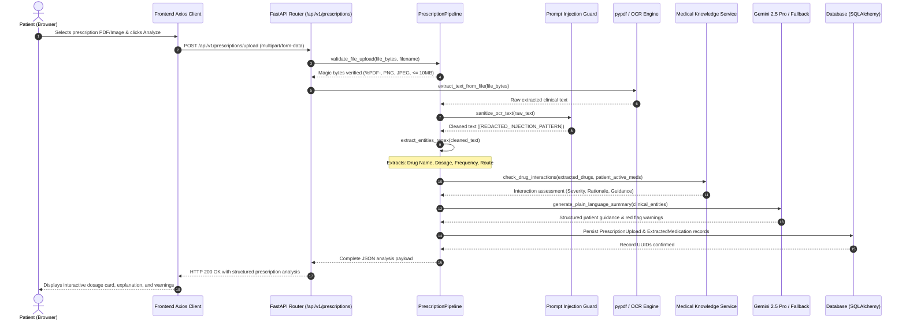
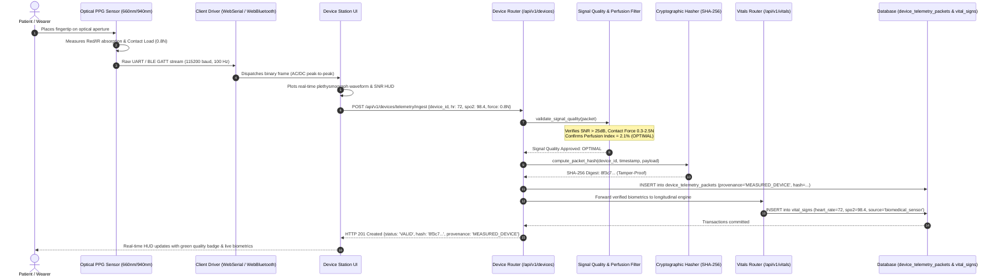

# MediCare AI — Data Flow & Lifecycle Specifications

**Document Version:** 1.0.0  
**Project:** MediCare AI — Healthcare Management Platform  
**Live URL:** [https://medicare-ai-iv31.onrender.com](https://medicare-ai-iv31.onrender.com)  

---

## 1. Authentication and Token Lifecycle

Authentication in MediCare AI enforces dual-token cryptographic security with strict role-based authorization:

```
┌─────────────────────────────────────────────────────────────────────────────────┐
│                        AUTHENTICATION FLOW SEQUENCE                             │
└─────────────────────────────────────────────────────────────────────────────────┘
  Patient (Browser)              FastAPI Gateway               Database / Cache
         │                              │                             │
         │  1. POST /api/v1/auth/login  │                             │
         │─────────────────────────────>│                             │
         │     {email, password}        │  2. SELECT User by email    │
         │                              │────────────────────────────>│
         │                              │<────────────────────────────│
         │                              │     User record & hash      │
         │                              │                             │
         │                              │  3. Verify bcrypt/Argon2id  │
         │                              │  4. Mint JWT Access Token   │
         │                              │     (30m TTL, role, sub)    │
         │                              │  5. Mint JWT Refresh Token  │
         │                              │     (7d TTL, rotating)      │
         │  6. HTTP 200 OK              │                             │
         │<─────────────────────────────│                             │
         │     {access_token, refresh}  │                             │
         │                              │                             │
         │  7. GET /api/v1/auth/me      │                             │
         │     [Bearer Access Token]    │                             │
         │─────────────────────────────>│                             │
         │<─────────────────────────────│                             │
         │     User Profile & Role      │                             │
         │                              │                             │
```

### Security Details:
- **Password Protection:** Passwords are never stored in plaintext. They are salted and hashed using bcrypt with work factor 12.
- **Token Claims:** JWT payloads contain `sub` (user UUID), `role` (`patient`, `doctor`, `nurse`, `admin`), `exp` (expiration), and `iat` (issued at).
- **Session Expiration:** If an access token expires during an active session, Axios interceptors issue a single silent refresh request to `POST /api/v1/auth/refresh`. Auth endpoints themselves are strictly exempted from refresh retry loops to eliminate hanging request states.

---

## 2. Prescription Document Processing Data Flow



### Data Transformation Stages:
1. **Binary Ingestion:** File binary payload is validated in memory without executing shell commands or temporary file scripts. Magic bytes verify the true container format.
2. **Text Extraction:** Multi-page PDF text streams are extracted using `pypdf`. For image uploads, clean optical text passes to the preprocessing engine.
3. **Anti-Injection Sanitization:** Text is scanned against known injection regexes (`ignore previous instructions`, `you are now a`, `system: override`). Matched spans are replaced with `[REDACTED_INJECTION_PATTERN]`, and ASCII control characters are stripped.
4. **Clinical Entity Recognition:** Regular expressions extract canonical medication names, numerical strengths (mg, mcg, g, mL), dosage forms (tablet, capsule, liquid), routes (PO, IV, PR), and frequencies (QD, BID, TID, QID, PRN).
5. **Drug-Drug Interaction Screening:** Extracted entities are cross-referenced with the patient's existing medication list against the rule-based interaction matrix (e.g., Warfarin + Aspirin -> High Risk Bleeding; ACE inhibitor + Potassium -> Hyperkalemia).
6. **Plain-Language Synthesis:** Generative AI compiles patient-friendly instructions explaining why the medication is taken, what side effects to watch for, and food/timing advice.

---

## 3. Vital Signs Telemetry and Clinical Alerting Flow

```mermaid
sequenceDiagram
    autonumber
    actor Patient as Patient
    participant UI as VitalSense UI
    participant API as Vitals Router (/api/v1/vitals)
    participant Evaluator as Clinical Guideline Evaluator
    participant AlertEng as Clinical Alert Engine
    participant DB as Database (vital_signs & vital_alerts)
    actor Doctor as Clinician / Doctor

    Patient->>UI: Enters BP (145/92 mmHg) & Pulse (78 BPM)
    UI->>UI: Validates physiologic bounds (60-260 SBP, 40-160 DBP)
    UI->>API: POST /api/v1/vitals/blood-pressure {source: 'manual_home_cuff'}
    API->>Evaluator: Compute MAP and classify AHA category
    Note over Evaluator: MAP = 92 + (145-92)/3 = 109.7 mmHg<br/>Category: Hypertension Stage 2
    API->>AlertEng: evaluate_vital_reading(reading_data)
    AlertEng-->>API: High-Priority Clinical Alert Flagged
    API->>DB: INSERT into vital_signs (is_sample=false, source='manual_home_cuff')
    API->>DB: INSERT into vital_alerts (severity='WARNING', status='ACTIVE')
    DB-->>API: Records persisted successfully
    API-->>UI: HTTP 201 Created {vital_id, map: 109.7, category: 'Stage 2'}
    UI-->>Patient: Displays longitudinal chart point & cautionary banner
    
    rect rgb(20, 30, 45)
    Note over Doctor,DB: Asynchronous Clinician Triage Workflow
    Doctor->>API: GET /api/v1/vitals/doctor/alerts
    API->>DB: SELECT active alerts JOIN vital_signs
    DB-->>API: Returns active Stage 2 HTN alert
    API-->>Doctor: Alert queue populated with patient record
    Doctor->>API: POST /api/v1/vitals/alerts/{id}/action {note: 'Dose adjustment review'}
    API->>DB: UPDATE vital_alerts SET status='RESOLVED', actioned_by=doctor_id
    DB-->>API: Updated
    API-->>Doctor: Alert dismissed with timestamped audit confirmation
    end
```



### Telemetry Provenance and Integrity:
Every entry written to the `vital_signs` table is stamped with rigorous provenance flags:
- `is_sample` (Boolean): `false` for real patient measurements; `true` for simulator/demo bench data.
- `measurement_source` (Enum):
  - `manual_home_cuff`: User-entered blood pressure from an oscillometric home cuff.
  - `manual_fingerstick`: User-entered capillary blood glucose from an electrochemical meter.
  - `hardware_ble`: Automatically ingested from a paired Bluetooth Low Energy GATT device.
  - `experimental_webcam_rppg`: Ingested from the client-side optical pulse research tool.
  - `sample_data`: Ingested via demo bench simulation.
- `is_patient_entered` (Boolean): Differentiates self-reported patient telemetry from clinician measurements recorded during hospital encounters.

---

## 4. Biomedical Sensor Telemetry Ingestion & Signal Quality Indexing (SQI)



### Signal Validation & Provenance Verification:
1. **Signal-to-Noise Ratio (SNR):** The sensor pipeline rejects readings where SNR < 25 dB, flagging poor photodiode alignment or excessive ambient light leakage.
2. **Contact Pressure Bounds:** Enforces 0.3 N to 2.5 N contact force to prevent capillary occlusion (from pressing too hard) or signal dropouts (from insufficient contact).
3. **Perfusion Index (PI):** Evaluates pulsatile (AC) to non-pulsatile (DC) infrared absorption. Signals below 0.2% are classified as `POOR_PERFUSION`.
4. **Cryptographic Integrity:** Ingested packets receive a unique SHA-256 hash calculated across `device_id`, `packet_timestamp`, and the biometric payload to guarantee auditability under HIPAA §164.312(c)(1).

