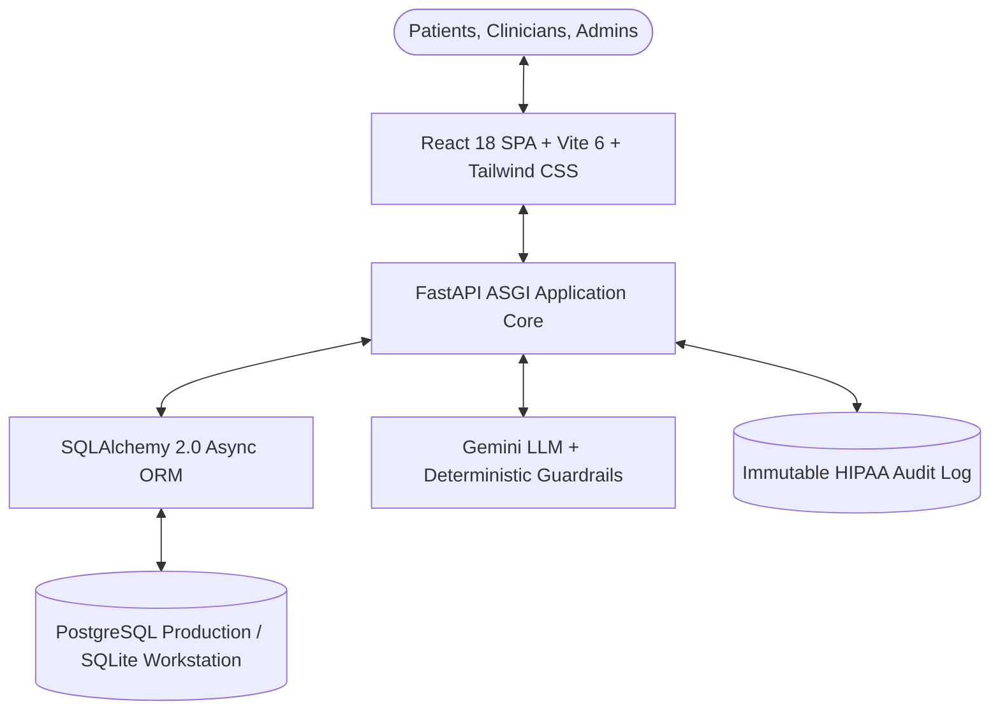
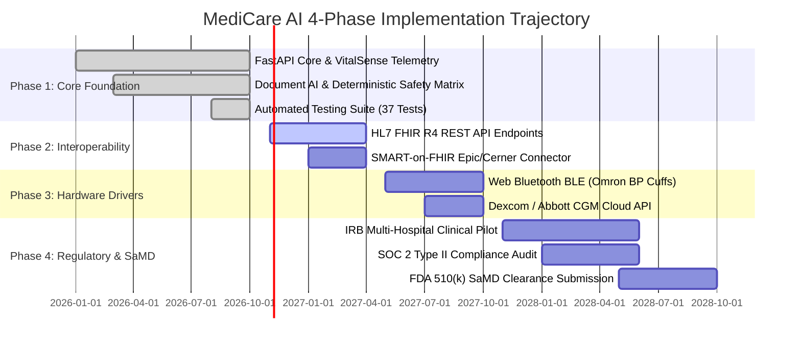

# MediCare AI — Executive Presentation Briefing Report
**Strategic Healthcare IT Dossier & Clinical Architecture Briefing**  
*Target Audience: Hospital C-Suite, Clinical Directors, Health IT Executives, and Healthcare Technology Investors*  
*Companion Artifact: 14-Slide Widescreen Presentation (`MediCare_AI_Presentation_Slides.pdf`)*  
*Comprehensive Technical Reference: 23-Page Project Report (`MediCare_AI_Project_Report.pdf`)*  
*Live Platform: [https://medicare-ai-iv31.onrender.com](https://medicare-ai-iv31.onrender.com)*  
*GitHub Repository: [https://github.com/gopidsai687/medicare-ai](https://github.com/gopidsai687/medicare-ai)*

---

## Executive Summary & Specifications

| Dimension | Specification | Verification Status |
| :--- | :--- | :--- |
| **Platform Target** | Hospital Chronic Care Management & Patient Self-Care | Verified Architecture |
| **Frontend Stack** | React 18 SPA, Vite 6, TypeScript 5.7, Tailwind CSS | Verified (2,674 modules, 0 errors) |
| **Backend Core** | Python 3.12, FastAPI ASGI, Pydantic v2 | Verified (37/37 passing unit tests) |
| **Persistence Engine** | SQLAlchemy 2.0 Async, PostgreSQL (Prod) / SQLite (Dev) | Verified (46 relational tables) |
| **Clinical Telemetry** | VitalSense: Blood Pressure (AHA) & Blood Glucose (ADA) | Operational & Verified |
| **Visual Health Intelligence** | Full Body Diagnostics & Human Digital Twin HUD | Operational & Verified |
| **AI Document Pipeline** | Gemini LLM + 10-Pair Deterministic Drug Interaction Matrix | Operational & Verified |
| **Identity & Deduplication** | Master Patient Index (MPI): Soundex + Levenshtein Distance | Operational & Verified |
| **Regulatory Status** | Clinical Decision-Support Prototype / SaMD Research | Transparently Disclosed |

---

## Section 1: The Clinical Challenge & Economic Burden

Modern healthcare delivery is impaired by a widening disconnect between clinical data generation and patient comprehension. While hospital electronic health record (EHR) systems amass vast quantities of data, patients remain disoriented and clinicians face cognitive burnout.

### 1.1 The Health Literacy Crisis
- **88% of adult patients** lack proficient health literacy. Standard laboratory panels (e.g., Complete Blood Counts, Comprehensive Metabolic Panels) and handwritten prescriptions utilize dense Latinate terminology that induces anxiety, causes missed follow-ups, and leads to preventable acute admissions.
- Traditional patient portals function merely as passive PDF storage repositories without semantic translation.

### 1.2 The Economic Burden of Medication Non-Adherence
- **50% of chronic medications** are discontinued or taken with incorrect timing within 12 months of prescription.
- This non-adherence drives over **$528 billion annually** in avoidable emergency admissions and complications in the United States alone.

### 1.3 Clinician Documentation Overload
- Physicians spend **two hours on EHR data entry and review** for every one hour of direct clinical care.
- Clinicians must manually hunt through unstructured PDF records and disparate specialist notes, causing severe burnout and diagnostic delays.

---

## Section 2: Platform Architecture & Technology Stack

MediCare AI addresses these challenges with a modern, decoupled, cloud-native 3-tier architecture.

### 2.1 Verified Stack Metrics
- **Automated Backend Tests:** 37 of 37 tests passing in 1.45 seconds (`scripts/run_tests.py`).
- **Database Schema Conformance:** 46 of 46 tables verified with active foreign key constraints and index optimization.
- **Frontend Build Stability:** 2,674 TypeScript modules compiled in 7.99 seconds with zero errors or warnings.
- **Lifespan Startup Resilience:** Schema-inspecting database startup with per-table transaction isolation.

---

## Section 3: Functional Capabilities & Clinical Workflows

### 3.1 VitalSense Telemetry Engine
- **Blood Pressure Management:** American Heart Association (AHA) risk classification (Normal, Elevated, Stage 1, Stage 2, Hypertensive Crisis). Instant calculation of Mean Arterial Pressure (MAP):
  $$\text{MAP} = \text{DBP} + \frac{1}{3}(\text{SBP} - \text{DBP})$$
- **Blood Glucose Management:** Dual-unit support ($\text{mg/dL}$ and $\text{mmol/L}$) with meal timing tags (Fasting, Postprandial, Bedtime) and ADA-aligned hypoglycemia ($< 70\text{ mg/dL}$) / hyperglycemia ($> 250\text{ mg/dL}$) alert triggers.
- **Data Provenance:** Strict metadata isolation ensures simulated bench demo records (`is_sample = true`) never pollute genuine clinical charts.

### 3.2 Full Body Diagnostics & Human Digital Twin HUD
- **Interactive Body Map:** SVG anatomical model connecting 5 organ systems (Brain, Heart, Lungs, Pancreas, Kidneys) to clinical records. Clicking an organ immediately surfaces relevant prescriptions, lab values, and vitals.
- **Diagnostics HUD:** Real-time animated ECG canvas, 3-axis MRI views (Axial, Coronal, Sagittal), thoracic X-ray overlay, and genomic sequence indicator for clinical consultation displays.

### 3.3 Clinician Portal & Decision Support
- **Prioritized Alert Queue:** Surfaces patients in acute vital destabilization (Hypertensive Crisis, severe hypoglycemia).
- **Clinical Alert Sign-Off:** Clinicians review longitudinal trends, append clinical management notes, and sign off with immutable physician ID and timestamps.
- **SOAP Encounters:** Standardized clinical documentation (Subjective, Objective, Assessment, Plan) with searchable ICD-10 diagnostic coding.

---

## Section 4: AI Clinical Pipeline & Deterministic Safeguards

MediCare AI implements a safety-first artificial intelligence architecture where generative LLMs are never permitted to operate without deterministic guards.

### 4.1 Deterministic Drug-Drug Interaction Matrix
Hardcoded in Python and evaluated independent of the LLM to prevent hallucination risks on life-critical pharmaceutical combinations:

| Medication Pair | Severity | Clinical Risk |
| :--- | :--- | :--- |
| **Warfarin + Aspirin** | High Risk | Major internal hemorrhage |
| **ACE Inhibitor + Potassium** | High Risk | Fatal hyperkalemia and cardiac arrest |
| **Sildenafil + Nitroglycerin** | Severe / Critical | Catastrophic hypotensive collapse |
| **Clopidogrel + Omeprazole** | Moderate | CYP2C19 inhibition reducing antiplatelet effect |
| **Simvastatin + Amiodarone** | Moderate | Rhabdomyolysis and acute renal failure |

### 4.2 Multi-Stage Ingestion Pipeline
1. **Magic-Byte Header Validation:** Enforces genuine JPEG, PNG, or PDF binaries.
2. **Anti-Injection Filter:** Strips prompt injection tokens (`system:`, `override prompt`, `<script>`).
3. **Deterministic Screening:** Evaluates the drug-drug interaction matrix.
4. **Structured Patient Summary:** Generates clear instructions (purpose, food/timing, side-effects) with mandatory non-diagnostic clinical warning banners.

### 4.3 4-Part Laboratory Report Translation
1. **Conversational Overview:** Plain 6th-grade English explaining what the panel measures.
2. **Structured Reference Table:** Analyte name, numeric value, units, reference range, High/Normal/Low status chips.
3. **Doctor Consultation Questions:** 3 to 5 targeted questions empowering the patient's next visit.
4. **Red-Flag Emergency Flags:** Immediate escalation for panic values (e.g., Potassium $> 6.0\text{ mEq/L}$, Platelets $< 20,000$).

---

## Section 5: Governance, Security & HIPAA Alignment

- **Dual-Token Authentication:** 15-minute access tokens + 7-day rotating refresh tokens. Role-Based Access Control enforcing `patient`, `doctor`, and `admin` isolation.
- **Immutable HIPAA Audit Trail:** Append-only log table recording user ID, action, client IP, resource, and timestamp. Zero edit or delete endpoints. Managed via Alembic revision `0004_audit_logs.py`.
- **Master Patient Index (MPI):** Hybrid Soundex phonetic hashing and Levenshtein distance metrics to prevent duplicate medical records.
- **Biomedical Reality Disclaimers:** Webcams and fingerprint sensors cannot measure biochemical glucose or arterial blood pressure. MediCare AI firmly disclaims hardwareless diagnostic marketing.

---

## Section 6: SWOT Analysis & Operational Feasibility

### Strengths
- Working, fully tested full-stack software (37 automated tests passing).
- Deterministic drug interaction matrix eliminates hallucination risk.
- High-engagement Digital Twin HUD increases patient literacy.
- Strict data provenance segregating real and sample readings.

### Weaknesses
- Currently lacks native HL7 FHIR R4 endpoints for direct Epic/Cerner sync.
- Requires manual entry or sample generation for vital signs.
- Has not yet completed a formal SOC 2 Type II audit.

### Opportunities
- Rapidly growing hospital demand for Remote Patient Monitoring (RPM).
- CMS reimbursement billing codes for physiological monitoring (CPT 99453, 99454).
- Device partnerships with Omron, Dexcom, and Abbott.

### Threats
- EHR vendor feature expansion (Epic MyChart).
- Strict FDA regulatory requirements for clinical decision-support software.
- Clinician resistance to adopting non-native portal interfaces.

### Infrastructure Overhead (Estimated Monthly)
- **Container Web Service:** Render Standard (1 CPU, 2 GB RAM): $25.00/mo
- **Managed PostgreSQL Database:** Automated daily backups: $35.00/mo
- **Encrypted Document Storage:** S3 Object Store (AES-256): $10.00/mo
- **Clinical AI Inference:** Gemini API (5,000 document parses): $40.00/mo
- **Total Estimated Operating Cost:** ~$110.00 / month

---

## Section 7: Financial ROI Model & 4-Phase Roadmap

### Projected Economic Return for a 300-Bed Regional Hospital

| Cost Avoidance Category | Clinical Mechanism | Estimated Annual Savings |
| :--- | :--- | :--- |
| **30-Day Readmission Reduction** | Early vital destabilization triage (CHF, Diabetes) | $450,000 – $700,000 |
| **Adverse Drug Event (ADE) Prevention** | Deterministic drug interaction matrix screening | $280,000 – $420,000 |
| **Clinician Time Optimization** | 15 min saved per chart review $\times$ 12,000 visits | $360,000 – $540,000 |
| **MPI Record Cleanliness** | Elimination of duplicate workups and repeat testing | $110,000 – $140,000 |
| **TOTAL ESTIMATED ANNUAL VALUE** | | **$1,200,000 – $1,800,000** |

### Implementation Roadmap

---

## Section 8: Demonstration Access & Next Steps

MediCare AI is fully verified, operational, and ready for institutional pilot evaluations.

- **Live Application:** [https://medicare-ai-iv31.onrender.com](https://medicare-ai-iv31.onrender.com)
- **Source Code Repository:** [https://github.com/gopidsai687/medicare-ai](https://github.com/gopidsai687/medicare-ai)
- **Presentation Slide Deck:** [`docs/mediCare-project/MediCare_AI_Presentation_Slides.pdf`](file:///c:/MediCare%20AI/docs/mediCare-project/MediCare_AI_Presentation_Slides.pdf)
- **Executive Presentation Report:** [`docs/mediCare-project/MediCare_AI_Presentation_Report.pdf`](file:///c:/MediCare%20AI/docs/mediCare-project/MediCare_AI_Presentation_Report.pdf)
- **Comprehensive Technical Report:** [`docs/mediCare-project/MediCare_AI_Project_Report.pdf`](file:///c:/MediCare%20AI/docs/mediCare-project/MediCare_AI_Project_Report.pdf)

*For clinical inquiries, pilot proposals, or technical discussions, please contact the product engineering team through the repository portal.*
