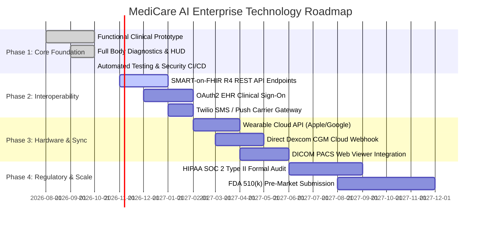

# MediCare AI — Strategic Roadmap, SWOT Analysis & Business Value

**Document Version:** 1.0.0  
**Project:** MediCare AI — Healthcare Management Platform  
**Live URL:** [https://medicare-ai-iv31.onrender.com](https://medicare-ai-iv31.onrender.com)  

---

## 1. Business Value & Management Briefing

Healthcare delivery organizations face mounting challenges: escalating chronic disease burdens, clinical workforce shortages, and patient disengagement driven by incomprehensible clinical documentation. MediCare AI provides measurable strategic value across three key healthcare operational domains:

### A. Value for Healthcare Systems and Hospital Networks
- **Reduction in Preventable Hospital Readmissions:** By enabling continuous home blood pressure and glucose tracking with automated clinical alert thresholds, clinicians can intervene before an ambulatory patient deteriorates into acute hypertensive crisis or diabetic ketoacidosis.
- **Clinician Documentation Efficiency:** The AI document pipeline summarizes multi-page lab reports and complex medication lists, saving physicians an estimated 3–5 minutes per patient encounter during chart review.
- **Enterprise Identity Hygiene:** The Master Patient Index (MPI) deduplication tool provides automated probabilistic matching, helping medical records teams eliminate duplicate charts that cause redundant testing and medical errors.

### B. Value for Patients and Caregivers
- **Health Literacy Empowerment:** Translating clinical terms (e.g., *thrombocytopenia*, *eGFR*, *cardiomegaly*) into plain, conversational language demystifies laboratory reports and builds trust between patients and care teams.
- **Medication Adherence:** Clear, structured instructions detailing when to take medications, food interactions, and contraindications reduce accidental non-adherence.
- **Centralized Health Records:** Consolidates appointments, prescriptions, and vitals history in a single accessible mobile-ready portal.

---

## 2. Strategic SWOT Analysis

```
┌─────────────────────────────────────────────────────────────────────────────────┐
│                                 SWOT ANALYSIS                                   │
├────────────────────────────────────────┬────────────────────────────────────────┤
│ STRENGTHS                              │ WEAKNESSES                             │
├────────────────────────────────────────┼────────────────────────────────────────┤
│ • Full-stack, operational application  │ • Not yet FDA 510(k) cleared as SaMD   │
│   verified with 37 automated tests.    │ • Dependent on manual entry or BLE;    │
│ • Zero-configuration deployment model  │   no direct continuous CGM cloud sync. │
│   (SQLite fallback + PostgreSQL).      │ • Third-party cloud AI latency (Gemini)│
│ • Deterministic clinical rule fallback │   can vary with network conditions.    │
│   ensures safety if cloud is offline.  │ • Limited formal EHR integration       │
│ • Robust anti-prompt-injection and     │   (lacks native Epic/Cerner SMART App).│
│   binary magic-byte file security.     │                                        │
├────────────────────────────────────────┼────────────────────────────────────────┤
│ OPPORTUNITIES                          │ THREATS                                │
├────────────────────────────────────────┼────────────────────────────────────────┤
│ • Integration with HL7 FHIR v4.0.1 for │ • Stringent healthcare regulations     │
│   seamless hospital EHR interoperability. (HIPAA audit liability, FDA oversight)│
│ • Partnership with medical device      │ • Rapidly evolving generative AI       │
│   manufacturers (Omron, Dexcom).       │   hallucination risks in clinical data.│
│ • Remote Patient Monitoring (RPM)      │ • Reluctance of traditional hospital   │
│   CPT billing code reimbursement.      │   IT departments to adopt modern cloud │
│ • Expansion into multi-language        │   SaaS architectures.                  │
│   patient translations (Spanish, etc.).│                                        │
└────────────────────────────────────────┴────────────────────────────────────────┘
```

---

## 3. Multi-Phase Implementation Roadmap



### Phase 1: Baseline Architecture & Clinical Integrity (Current Status — Complete)
- Deploy unified responsive web portal with role-based access for Patient, Doctor, and Admin.
- Implement VitalSense manual logging for Blood Pressure and Glucose with AHA/ADA clinical classifications.
- Build prescription and lab report processing pipelines with anti-injection sanitization.
- Establish automated CI/CD pipeline on GitHub Actions with 100% schema conformance and test passes.

### Phase 2: Enterprise Interoperability & Communications (Q4 2026 – Q1 2027)
- **HL7 FHIR R4 Integration:** Expose standard FHIR endpoints (`/fhir/Patient`, `/fhir/Observation`, `/fhir/Condition`, `/fhir/MedicationStatement`) to allow bi-directional syncing with hospital EHRs.
- **Carrier Communication Gateway:** Integrate Twilio API and WebPush VAPID servers to dispatch SMS reminders for medication adherence and critical vital threshold alerts.
- **SMART App Launch:** Enable doctors to launch MediCare AI directly within the Epic Hyperspace or Cerner PowerChart canvas via OAuth2 SMART-on-FHIR launch protocols.

### Phase 3: Wearable Ecosystem & Diagnostics (Q2 2027 – Q3 2027)
- **Direct Wearable Cloud Sync:** Implement RESTful OAuth2 webhooks connecting to Apple HealthKit, Google Health Connect, and Garmin Health APIs for passive resting heart rate and step telemetry.
- **Continuous Glucose Monitor (CGM) Webhooks:** Establish direct developer API streaming from Dexcom G7 and Abbott FreeStyle Libre systems.
- **DICOM Imaging Viewer:** Integrate Cornerstone.js / OHIF viewer for clinical radiology viewing (X-rays, CT scans, MRIs) with radiological report cross-referencing.

### Phase 4: Formal Clinical Certification & Hospital Scaling (Q3 2027 – Q4 2027)
- **Regulatory Submissions:** Conduct formal institutional review board (IRB) clinical validation trials to measure diagnostic explanation accuracy, and submit FDA 510(k) documentation for Software as a Medical Device.
- **Security & Compliance Audits:** Complete third-party SOC 2 Type II, ISO 27001, and formal HIPAA HITRUST security assessments.
- **Enterprise Multi-Tenancy:** Partition the database into multi-tenant hospital network domains with isolated encryption keys and custom hospital branding.
