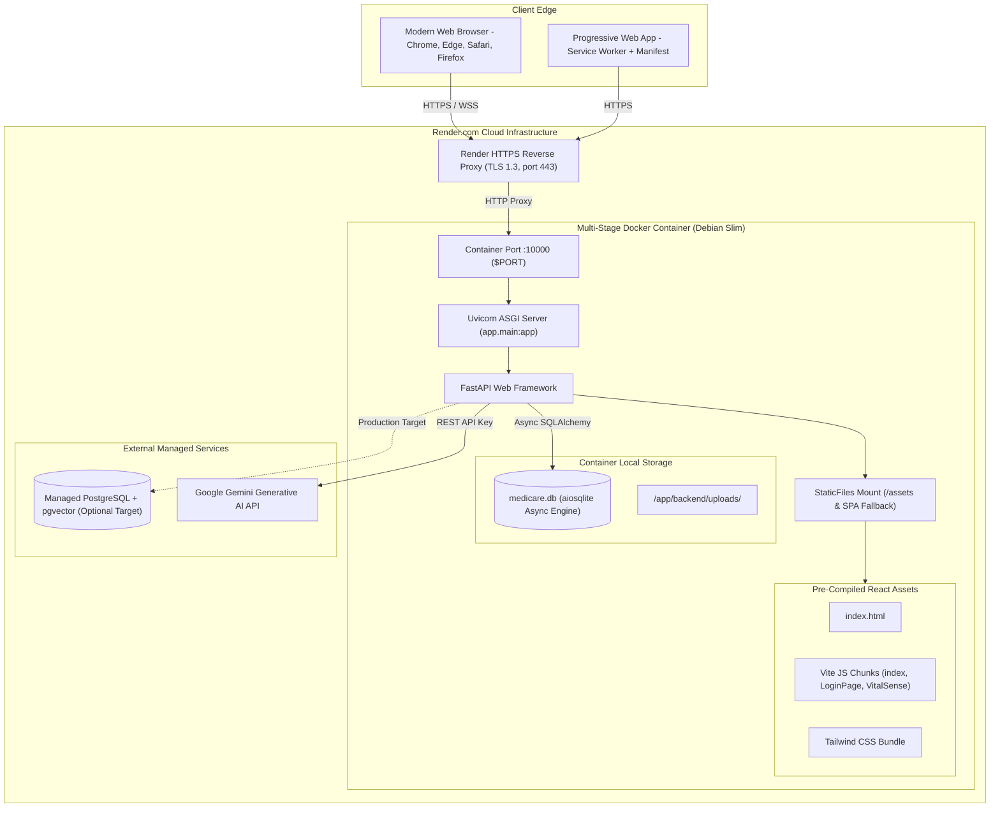

# MediCare AI — System Architecture Specification

**Document Version:** 1.0.0  
**Project:** MediCare AI — Healthcare Management Platform  
**Live URL:** [https://medicare-ai-iv31.onrender.com](https://medicare-ai-iv31.onrender.com)  
**Repository:** [https://github.com/gopidsai687/medicare-ai](https://github.com/gopidsai687/medicare-ai)  

---

## 1. Architectural Philosophy and Overview

### Plain-Language Summary for Stakeholders and Hospital Managers
MediCare AI is constructed as a secure, unified digital health web application. Rather than requiring users to install complex desktop software or manage multiple disparate portals, the system is delivered directly through modern web browsers. It functions like an intelligent clinical operating system:
- **At the front:** Patients and clinicians interact with an intuitive, responsive interface optimized for desktop and mobile devices.
- **In the middle:** A high-speed, secure application server verifies user identities, applies clinical guidelines, screens for medication interactions, and processes uploaded documents.
- **At the foundation:** A healthcare database organizes patient records, appointments, and vitals with strict privacy controls, ensuring that patients only ever see their own records and doctors only access authorized clinical data.

---

### Technical Specification for Software Architects and IT Directors
From an engineering perspective, MediCare AI implements a modern **Single-Page Application (SPA) + Asynchronous REST API Architecture** with an embedded production delivery model:
- **Presentation Layer:** Built with React 18, TypeScript 5.7, Vite 6, and Tailwind CSS. The client operates entirely asynchronously using React Query and Axios with custom interceptors, structured state guards, and deterministic timeouts (15s).
- **Application & API Layer:** Powered by Python 3.12 and FastAPI running on the Uvicorn ASGI server. The backend features strict Pydantic v2 data validation, structured logging via `structlog`, and dependency-injected database sessions.
- **Persistence Layer:** Uses SQLAlchemy 2.0 Async ORM with dual-engine capability: portable async SQLite (`sqlite+aiosqlite`) for zero-configuration demonstrations and managed PostgreSQL with `asyncpg` and `pgvector` for enterprise production deployments.
- **Embedded Production Delivery:** The compiled React bundle is served directly by FastAPI via Starlette `StaticFiles` with SPA route fallback, eliminating Cross-Origin Resource Sharing (CORS) preflight latencies and simplifying containerization.

---

## 2. High-Level Architecture Diagram

```mermaid
graph TB
    subgraph Hardware ["Biomedical Hardware & Physical Sensor Layer"]
        HW_PPG[Dual-Wavelength Optical PPG Sensor<br/>660nm Red / 940nm IR + Photodiode]
        HW_BP[Bluetooth BLE Blood Pressure Cuff<br/>IEEE 1708 Oscillometric Reference]
        HW_CGM[Continuous Glucose Monitor<br/>Subcutaneous Interstitial Sensor]
        HW_Aux[Dermal Thermopile & Piezo Contact Load Cell<br/>Skin Temperature & Force 0.3-2.5N]
    end

    subgraph Users ["User Layer"]
        P[Patient Users & Wearer]
        D[Clinicians & Attending Physicians]
        A[Hospital Administrators & Compliance Officers]
    end

    subgraph Presentation ["Presentation Layer (React 18 + Vite + Tailwind CSS)"]
        UI_Login[Authentication & Role-Based Session Guards]
        UI_Pat[Patient Portal & VitalSense Digital Twin HUD]
        UI_Dev[Biomedical Device Station & Real-Time Waveform]
        UI_Doc[Doctor Triage Dashboard & Clinical Alert Queue]
        UI_Adm[Admin Governance, Audit Trail & MPI Explorer]
        UI_Bridges[Client Protocol Adapters<br/>WebBluetooth GATT | WebSerial CDC | WebSocket]
    end

    subgraph Gateway ["Application & API Gateway Layer (FastAPI + Python 3.12)"]
        API_Auth[Auth Router & JWT Bearer Security]
        API_Dev[Device Management & Telemetry Router /api/v1/devices]
        API_Vitals[VitalSense & Telemetry Router /api/v1/vitals]
        API_AI[AI Diagnostic & Document Pipelines]
        API_Clin[Appointments, Encounters, Labs Router]
        API_Gov[Audit Logs & Master Patient Index Router]
    end

    subgraph Logic ["Business Logic, Signal Processing & Clinical Engines"]
        ENG_SQI[Signal Quality Indexing SQI & Perfusion Filter<br/>AC/DC Ratio, Motion Artifact, Contact Force Bounds]
        ENG_Prov[Cryptographic Packet Hasher & Provenance Guard<br/>SHA-256 Hash, Sensor Truth Audit]
        ENG_AHA[AHA/ADA Vitals Evaluator & MAP Engine<br/>Mean Arterial Pressure & Stage 1-2 HTN Bounds]
        ENG_Alert[Clinical Safety & Stale Alert Generator]
        ENG_Doc[OCR Sanitizer & Anti-Prompt-Injection Shield]
        ENG_KB[Deterministic Drug-Drug Interaction KB]
        ENG_AI[Google Gemini 2.5 Pro Generative Clinical Engine]
    end

    subgraph Data ["Data & Persistence Layer"]
        ORM[SQLAlchemy 2.0 Async ORM]
        DB_PG[(PostgreSQL + pgvector / SQLite Fallback)]
        DB_Telemetry[(Raw High-Frequency Telemetry & Packet Hashes)]
        DB_Clinical[(Clinical Records, Vitals & Alerts)]
        FS[Encrypted Local Medical Report Storage]
    end

    subgraph Infrastructure ["Cloud Infrastructure (Docker on Render.com)"]
        Render_Proxy[Render Reverse Proxy / TLS 1.3 Termination]
        Uvicorn_App[Uvicorn ASGI Container Process]
    end

    HW_PPG & HW_BP & HW_CGM & HW_Aux --> UI_Bridges
    Users --> Presentation
    UI_Bridges --> UI_Dev
    Presentation --> Gateway
    Gateway --> Logic
    Logic --> Data
    Infrastructure --> Gateway
```

---

## 3. Detailed Component Architecture

```mermaid
graph LR
    subgraph Frontend ["React SPA Frontend"]
        Router[React Router v6]
        AuthCtx[Auth Context & State Store]
        AxiosClient[Axios API Client with 15s Timeout]
        HardwareDrivers[Hardware Drivers: WebSerial 115.2k | WebBluetooth GATT]
        
        subgraph Views ["Client Views"]
            V_Vital[VitalSense & Digital Twin HUD]
            V_Device[Device Connections & Waveforms]
            V_Presc[Prescription Analysis UI]
            V_Report[Medical Report Analysis UI]
            V_DocAlert[Doctor Alert Queue UI]
            V_Audit[Admin Audit Log UI]
        end
    end

    subgraph Backend ["FastAPI Application (app.main:app)"]
        Middleware[CORS & TrustedHost Middleware]
        Lifespan[Lifespan Startup & Schema Inspector]
        
        subgraph Routers ["API v1 Routers"]
            R_Auth["/api/v1/auth"]
            R_Vitals["/api/v1/vitals"]
            R_Devices["/api/v1/devices"]
            R_Presc["/api/v1/prescriptions"]
            R_Report["/api/v1/medical-reports"]
            R_Audit["/api/v1/audit-logs"]
        end

        subgraph CoreServices ["Core Clinical Services"]
            S_AI[AIService - Gemini 2.5 Pro]
            S_DeviceEng[Device & SQI Feasibility Engine]
            S_PrescPipe[PrescriptionPipeline - pypdf & OCR]
            S_ReportPipe[MedicalReportPipeline - 37 Term Dict]
            S_Alert[AlertEngine - Clinical Safety Bounds]
            S_KB[MedicalKnowledge - Interaction Pairs]
        end
    end


    subgraph Database ["Database Layer"]
        Models[SQLAlchemy 2.0 Async Models]
        ConnPool[Async Engine Connection Pool]
        Schema[(PostgreSQL / SQLite medicare.db)]
    end

    Views --> AxiosClient
    AxiosClient --> Middleware
    Middleware --> Routers
    Routers --> CoreServices
    CoreServices --> Models
    Models --> ConnPool
    ConnPool --> Schema
```

---

## 4. Layer-by-Layer Architectural Breakdown

### 1. User Layer
- **Patients:** Access personal dashboard, record manual vitals, upload documents, view AI summaries, explore the body map.
- **Doctors & Clinical Staff:** Review assigned patient panels, triage alert queues, conduct clinical encounters with SOAP documentation, review longitudinal histories.
- **Hospital Administrators:** Monitor system health, manage staff accounts, inspect HIPAA audit trails, execute MPI patient deduplication and merges.

### 2. Presentation Layer
- **Framework & Tooling:** React 18 with Vite 6.0 and TypeScript 5.7.
- **Component System:** Headless UI primitives from Radix UI (`@radix-ui/react-dialog`, `@radix-ui/react-dropdown-menu`, `@radix-ui/react-tooltip`) styled with utility-first Tailwind CSS.
- **Data Visualization:** Recharts for longitudinal vital sign graphs (systolic/diastolic dual line charts, glycemic scatter plots) and custom SVG components for anatomical mapping and Digital Twin telemetry.
- **Client Reliability:** Axios client configured with a global 15,000ms timeout, request/response interceptors with refresh token loop suppression, and submission guards preventing double clicks.

### 3. Application & API Layer
- **Framework:** FastAPI running on Uvicorn ASGI server.
- **Routing & Modular Endpoints:** 17 distinct API routers partitioned under `/api/v1/*`.
- **Security & Middleware:**
  - `CORSMiddleware`: Strict origin whitelisting in production with regex support for dynamic subdomains.
  - `TrustedHostMiddleware`: Enforces domain integrity when running in production mode.
  - `lifespan`: Non-fatal application startup lifecycle using SQLAlchemy `inspect` to verify and migrate database columns without poisoning database transactions.
  - Direct health-check endpoint at `/api/health` responding in $< 5\text{ms}$.

### 4. Business Logic & Clinical Services Layer
- **Clinical Evaluation:**
  - `classify_blood_pressure`: Evaluates SBP/DBP against American Heart Association (AHA) 2017 clinical guidelines.
  - `classify_blood_glucose`: Evaluates fasting and postprandial glucose values against American Diabetes Association (ADA) 2024 standards.
  - `AlertEngine`: Identifies critical threshold breaches and manages clinician triage queues.
- **Document Intelligence:**
  - `PrescriptionPipeline`: Magic-byte validation, prompt-injection redaction, multi-page text extraction (`pypdf`), medication entity extraction, and drug-drug interaction screening.
  - `MedicalReportPipeline`: Multi-page clinical lab extraction, 37-term plain-language dictionary lookup, reference range comparison, and red-flag emergency detection.
- **AI Integration:** `AIService` connecting to Google Gemini 2.5 Pro with an autonomous rule-based clinical reasoning fallback engine for zero-dependency reliability.

### 5. Data & Persistence Layer
- **ORM:** SQLAlchemy 2.0 with asynchronous session management (`AsyncSession`, `async_sessionmaker`).
- **Database Strategy:**
  - **Primary Production Engine:** Managed PostgreSQL 16+ via `postgresql+asyncpg://` with `pgvector` extension support for vector embeddings.
  - **Self-Healing Fallback Engine:** Embedded SQLite via `sqlite+aiosqlite://` with automatic schema self-healing, guaranteeing zero-downtime portability.
- **Storage Strategy:** Local encrypted filesystem directory `/app/backend/uploads/` for patient document files with sanitized UUID naming conventions.

### 6. Deployment Layer
- **Multi-Stage Containerization:** Docker multi-stage build (`node:20-alpine` frontend builder with 512MB RAM cap + `python:3.12-slim` production image).
- **Cloud Hosting:** Hosted on Render Cloud Platform with HTTPS reverse proxy, automatic Let's Encrypt TLS 1.3 termination, and direct health check monitoring at `/api/health`.

---

## 5. Deployment Architecture Diagram


