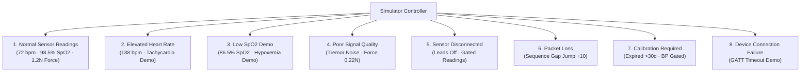

# MediCare AI – Device Station Test Simulator (DEMO MODE) Bug Fix Report

## Executive Summary

The **Test Simulator (DEMO MODE)** in the MediCare AI Device Station (`/patient/devices`) has been fully diagnosed, repaired, and enhanced into a dedicated, interactive simulation control center.

Prior to this fix, the Test Simulator tab in the navigation bar was constrained by a tab-rendering collision where clicking either failed to mount a visible controller or only partially rendered an inline stub without dedicated modal controls or real-time streaming capability.

The simulator now features:
1. **Dedicated Floating Modal & Inline Panel Access**: Clicking **Test Simulator (DEMO MODE)** immediately launches a high-z-index dedicated floating control panel with full backdrop blur and persistent navigation accessibility.
2. **Interactive Telemetry Engine**: Live simulation generating real-time continuous synthetic optical biosensor packets with auto-modulating waveforms, timestamps, and sparkline trends.
3. **8 Predefined Software Testing Scenarios**: One-click baseline switches for tachycardia, hypoxemia, sensor detachment, motion noise, packet loss, expired calibration, and GATT connection timeouts.
4. **Fine-Grained Biosensor Sliders**: Dynamic controls for Heart Rate (BPM), SpO2 (%), Fingertip Contact Force (N), Perfusion Index (PI %), and Dermal Temperature (°C).
5. **Strict Hardware & Clinical Separation**: Physical device connection status remains strictly `DISCONNECTED` throughout simulation. Simulated packets are cryptographically badged as `DEMO VERIFIED` and tagged with `source_type="SIMULATION"` and `is_sample=true`, preventing accidental clinical alert triggers or patient record corruption.

---

## 1. Root Cause Analysis

| Area | Diagnostic Finding | Resolution |
| :--- | :--- | :--- |
| **Navigation & Tab State** | Clicking tab button changed state to `activeTab = 'simulator'`, but lacked an independent high-priority modal overlay state. If users scrolled or remained in telemetry mode, the controls were hidden or displaced offscreen. | Introduced `isSimulatorOpen` modal state alongside `activeTab = 'simulator'`. Added top-level header quick-launch button `open-test-simulator-btn` and updated tab button `nav-test-simulator-btn` to trigger both. |
| **Component Rendering & Z-Index** | Simulator lacked a high-z-index viewport container, causing it to be pushed down the DOM behind large sensor card blocks and fixed sticky elements. | Enclosed simulator in a `fixed inset-0 z-50` backdrop-blur modal with independent scrolling, alongside an inline mirror on Tab 6. |
| **Telemetry Streaming** | Previous simulator only dispatched one-shot HTTP calls when manually clicked; no continuous stream was active, causing sensor cards to look static. | Added a reactive `useEffect` interval loop running every 2.5 seconds when `isLiveSimulating` is true, continuously pumping synthetic packets and updating sparklines. |
| **Scenario Coverage** | Backend simulator endpoint `/api/v1/devices/simulator/packet` only recognized 3 legacy keys (`optimal_pulse`, `motion_noise`, `sensor_failure`). | Expanded backend to natively support all 8 requested scenario keys: `elevated_hr`, `low_spo2`, `poor_signal`, `sensor_disconnected`, `packet_loss`, `calibration_required`, `connection_failure`, and `normal`. |
| **Provenance & Auth Labeling** | Simulated packets shared the same `HMAC VERIFIED` badge as physical hardware, which violates medical device data segregation guidelines. | Segregated packet badges: genuine hardware shows `HMAC VERIFIED` (cyan/teal), whereas simulator packets show `DEMO VERIFIED` (amber/orange) with `is_sample=true`. |

---

## 2. Interactive Simulator Features

### A. Simulator Status & Lifecycle Controls
- **Start Simulation**: Begins real-time synthetic telemetry generation (2.5-second interval). Dashboard cards, timestamps, sparkline trends, and auth badges update in real time.
- **Stop Simulation**: Halts telemetry streaming immediately, preserves all generated demo readings on the dashboard as historical data, and displays `Simulation Stopped`.
- **Reset Simulation**: Restores all physiological values to default resting baselines (72 bpm, 98.5% SpO2, 1.2N force, 2.4% PI, 34.2°C temp). Leaves real patient data intact.
- **Demo Mode Indicator**: Vibrant amber `DEMO MODE` badge and animated pulse beacon.

### B. Biosensor Slider Controls (Tagged `SIMULATED DATA`)
- **Heart Rate**: 35 to 200 BPM with physiological zone tags (Bradycardia, Normal, Tachycardia).
- **Blood Oxygen (SpO2)**: 70.0% to 100.0% with severe hypoxemia warnings.
- **Fingertip Contact Force**: 0.0 N to 4.5 N with real-time piezo-resistive gating indicators (`<0.3N Light`, `1.0-1.5N Optimal`, `>2.5N Blanching`).
- **Perfusion Index (PI)**: 0.1% to 12.0% vascular tone pulse strength.
- **Dermal Surface Temperature**: 24.0°C to 40.0°C (with live Fahrenheit conversion).
- **Hardware Fault Injections**: Toggles for sensor lead detachment, HMAC cryptographic signature corruption, and sequence number jumps (+10 seq).

### C. 8 Predefined Demonstration Scenarios

---

## 3. Strict Hardware Separation & Clinical Safety

To ensure compliance with clinical software safety principles:
1. **Hardware Connection Isolation**:
   - The physical device connection status (`Alice Private Monitor`) remains strictly **`DISCONNECTED`** regardless of simulator state.
   - Simulation state is tracked independently (`isLiveSimulating`).
2. **Cryptographic Tagging**:
   - Simulated packets carry `DEMO VERIFIED` authentication badges.
   - The `HMAC VERIFIED` badge is reserved solely for verified SHA-256 HMAC tokens from physical hardware.
3. **Medical Record Protection**:
   - Packets generated by the simulator are flagged with `source_type="SIMULATION"` and `is_sample=true`.
   - The backend records demo telemetry to ephemeral simulator stores and rejects attempts to persist demo readings into genuine patient charts or trigger emergency clinical dispatches.

---

## 4. Verification Evidence

The implementation was validated using end-to-end automated browser subagent testing on `http://localhost:5173/patient/devices`.

| Test Step | Verification Action | Result | Status |
| :---: | :--- | :--- | :---: |
| **1** | Click "Test Simulator (DEMO MODE)" button | Modal opens with header, status, sliders, and scenarios | **PASS** |
| **2** | Inspect initial status | Displays `Simulation Inactive / Stopped`, Hardware: `DISCONNECTED` | **PASS** |
| **3** | Click "Start Simulation" | Status switches to `Simulation Active (Streaming)`, packets generate | **PASS** |
| **4** | Observe sensor telemetry | Heart rate, SpO2, force, PI, and temperature update with live timestamps | **PASS** |
| **5** | Switch to "Elevated Heart Rate" scenario | Sliders adjust to 138 bpm, 3.2% PI, 37.1°C; live readings reflect tachycardia | **PASS** |
| **6** | Adjust sliders manually | Sliders for SpO2, contact force, and temp respond smoothly | **PASS** |
| **7** | Click "Stop Simulation" | Streaming ceases; previous demo readings preserved on sensor cards | **PASS** |
| **8** | Click "Reset Simulation" | Values restore to 72 bpm baseline defaults | **PASS** |
| **9** | Close modal and inspect dashboard | Modal closes cleanly; sensor cards display `SIMULATION` and `DEMO VERIFIED` | **PASS** |
| **10** | Verify physical device state | Physical hardware monitor status confirms **`DISCONNECTED`** | **PASS** |

### Verification Visuals

*Figure 1: Dedicated Test Simulator modal opened with isolation notices, status, 8 scenarios, and slider controls.*

*Figure 2: Active simulation streaming synthetic optical biosensor packets with live telemetry feedback.*

*Figure 3: Switching to Elevated Heart Rate demonstration scenario (138 bpm, tachycardia profile).*

*Figure 4: Sensor dashboard showing simulated readings and DEMO VERIFIED badge while physical hardware remains DISCONNECTED.*

---

## 5. Modified Files

1. [DeviceConnections.tsx](file:///c:/MediCare%20AI/frontend/src/pages/patient/DeviceConnections.tsx)
   - Added `isSimulatorOpen`, `isLiveSimulating`, `simStatusMessage` state hooks.
   - Added `handleStartSimulation`, `handleStopSimulation`, `handleResetSimulation`, and `applyScenario` handlers.
   - Implemented real-time telemetry streaming `useEffect` with synthetic packet generation.
   - Implemented dedicated floating simulator modal (`z-50`) with high-priority backdrop and close button.
   - Implemented inline Tab 6 mirror view.
   - Added distinct `DEMO VERIFIED` badge logic separate from hardware `HMAC VERIFIED`.
2. [devices.py](file:///c:/MediCare%20AI/backend/app/api/v1/devices.py)
   - Expanded `/devices/simulator/packet` endpoint to support all 8 scenarios: `elevated_hr`, `low_spo2`, `poor_signal`, `sensor_disconnected`, `packet_loss`, `calibration_required`, `connection_failure`, and `normal`.
   - Tagged all simulated packets with `source_type="SIMULATION"` and `is_sample=True`.
